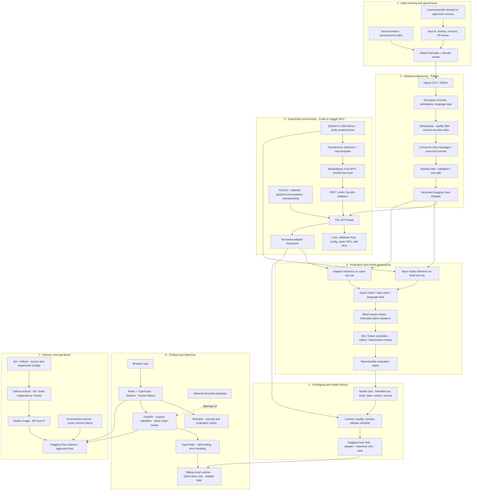

# Neural Studio — KannadaMind

**Project:** Adapt a small open model for useful Kannada–English question answering and college-support conversations with parameter-efficient LoRA fine-tuning.

This repository contains a responsive front end and a **FastAPI-to-Ollama local inference bridge**. Once the local model is pulled and Ollama is running, the playground sends questions to a real general-purpose model. This does not mean the KannadaMind LoRA adapter has been trained: the initial responses come from the base Qwen model. Training, measured evaluation, and publication are still separate project steps.

Link : https://neural-studio-pink.vercel.app/

## See the website

For real answers, start the local model runtime and the web app in two terminals:

```powershell
# Terminal 1, from the project root:
$env:OLLAMA_MODELS = (Resolve-Path .\work\ollama-models).Path
ollama serve
# Terminal 2, from the project root:
py -m pip install -r outputs/requirements.txt
ollama pull qwen2.5:1.5b
py -m uvicorn server:app --app-dir outputs --host 127.0.0.1 --port 8000
```

Then open `http://127.0.0.1:8000` in your browser and choose **AI Playground**. The Ollama model download is about 986 MB according to the [Ollama model library](https://ollama.com/library/qwen2.5). Keep both consoles open while chatting. API docs are available at `http://127.0.0.1:8000/docs`. On this computer the model is already downloaded into `work/ollama-models`, and the live site is running.

On Windows, the quick restart path is to launch `outputs/start-ollama.bat` first, then `outputs/start-website.bat`; leave both windows open. The model needs to be pulled only once. The Ollama startup script points the runtime at the project-local model cache.

If you open `index.html` directly, it cannot reach the FastAPI route; use the local server URL above. This computer has no NVIDIA GPU, so CPU generation can be slow. An English inference request returned a generated answer; a Kannada spot-check was garbled. Qwen2.5's [model listing](https://ollama.com/library/qwen2.5) describes multilingual support for over 29 languages, but Kannada quality is not established by that listing. The [Ollama chat API](https://github.com/ollama/ollama/blob/main/docs/api.md) is used behind FastAPI; FastAPI's route structure follows its [official first steps](https://fastapi.tiangolo.com/tutorial/first-steps/).

The interface includes the overview dashboard, 80+ language and locale choices, live chat through FastAPI when configured, dataset explorer and JSONL download, training configuration page, evaluation protocol, model-card outline, mobile navigation, neural mesh, and a gallery for the 15 supplied reference screenshots (`assets/reference-01.png` through `reference-15.png`). The reference images are design inspiration, not training data. System fonts and app code work locally; Google Fonts are an optional online enhancement.

## Full system architecture



### Component map

| Layer | Recommended tools | Responsibility | State in this deliverable |
|---|---|---|---|
| Data preparation | Python, Pandas, Hugging Face Datasets | Normalize, inspect, deduplicate, format and version Q&A examples | UI sample data only |
| Base model | Hugging Face Transformers, Qwen2.5-1.5B-Instruct | Tokenization, chat template and base inference | Displayed as project choice; not loaded |
| Efficient training | PyTorch, PEFT, LoRA/QLoRA, bitsandbytes, TRL SFTTrainer | Train adapter weights on a free Colab/Kaggle GPU; Unsloth is an optional acceleration path | Configuration is illustrative; no training code/checkpoint included |
| Tracking | Trainer logs or CSV/JSONL; optionally TensorBoard/W&B | Record loss, validation loss, hyperparameters, seed, GPU and duration | Loss visualization is explicitly illustrative |
| Evaluation | Python, Transformers, Pandas, human review | Compare base and adapter on identical held-out examples; report by language and task | Protocol and downloadable CSV template; no scores claimed |
| API | FastAPI, Pydantic, Python standard-library HTTP client, Ollama local API | Validate chat requests, relay language preference and history, return real local model answers | Implemented and connected to local runtime |
| UI | HTML, CSS, JavaScript (current). React, TypeScript, Tailwind, Framer Motion, Lucide React, Recharts (optional modernization) | Dashboard, live chat, language preference, training monitor, evaluation arena, dataset explorer and model card | Current static UI uses the same-origin FastAPI API for chat |
| Alternate demo | Streamlit | Quick model/data demo when the API is not needed | Optional, not implemented |
| Model distribution | Hugging Face Hub | Publish adapter and completed model card after review | Not published |
| Versioning and delivery | Git, GitHub, Docker, GitHub Actions | Track code, pin configs, package app, run automated checks and deploy | README blueprint only |

## Data contract

Use a conversation format that retains language and task metadata for analysis. Example JSONL record:

```json
{"messages":[{"role":"user","content":"ನಮಸ್ಕಾರ ಎಂದರೆ ಏನು?"},{"role":"assistant","content":"ನಮಸ್ಕಾರ ಎಂದರೆ hello ಅಥವಾ greetings ಎಂದು ಅರ್ಥ."}],"language":"kn","task":"definition","source":"authored","split":"train"}
```

Create the test split **before** augmentation or paraphrasing. Keep the split seed and source/license fields. Check Kannada Unicode normalization, near-duplicates, answer correctness, personally identifiable information, source terms, and native-speaker quality. Never put private college records into a public dataset without permission.

## Training plan

1. Curate 500–2,000 quality examples for one narrow task; start with one use case such as Kannada–English campus FAQ.
2. Split into train, validation, and held-out test sets. Keep a data card and exact dataset revision.
3. Run the unmodified base model on test prompts first; save prompt, generation settings, output, and score as the baseline.
4. Load the base with Transformers. Use 4-bit NF4 quantization when GPU memory requires it; attach LoRA through PEFT and train with TRL `SFTTrainer`. Unsloth can speed up compatible GPU runs.
5. Record learning rate, rank, alpha, dropout, epochs, batch size, sequence length, seed, GPU name, peak memory, runtime, and train/validation loss for every run. Compare two or three settings.
6. Evaluate base and adapter on the exact same held-out prompts and decoding settings. Report metrics separately for Kannada and English; include human-rated examples where the adapter improves and fails.
7. Publish only after confirming model/data license compatibility and completing the model card with real results.

## Chat API contract

The UI should call a same-origin API. Keep tokens and model access credentials on the server.

```http
POST /api/chat
Content-Type: application/json
```

```json
{"message":"ನಮಸ್ಕಾರ ಎಂದರೆ ಏನು?","language":"kn","history":[]}
```

```json
{"answer":"...","model":"qwen2.5:1.5b","language":"kn"}
```

The server also exposes `GET /api/health` and `GET /api/model`. It validates input length, returns actionable errors when Ollama is offline or the model is missing, and does not persist chat prompts. The language selector is sent as a system instruction; model quality still varies by language.

## Suggested repository when building the full stack

```text
kannadamind/
├── outputs/                    # Current standalone showcase
│   ├── index.html
│   ├── style.css
│   ├── app.js
│   ├── server.py              # FastAPI bridge to local Ollama inference
│   ├── requirements.txt
│   ├── start-ollama.bat       # Starts local model service with project model cache
│   ├── start-website.bat      # Starts the FastAPI website
│   ├── assets/                 # Supplied visual-reference screenshots
│   └── README.md
├── data/
│   ├── raw/                    # Permissioned source data; do not commit private data
│   ├── processed/
│   └── README.md               # Provenance, license, schema, split manifest
├── notebooks/
│   ├── 01_dataset_audit.ipynb
│   ├── 02_baseline_eval.ipynb
│   └── 03_lora_train_eval.ipynb
├── src/kannadamind/
│   ├── data.py                 # Validate, normalize, split, serialize
│   ├── train.py                # Transformers + PEFT + TRL / optional Unsloth
│   ├── evaluate.py             # Same-test-set baseline and adapter benchmark
│   └── inference.py            # Load base + adapter and generate
├── api/
│   ├── main.py                 # FastAPI routes
│   └── schemas.py              # Pydantic request / response schemas
├── frontend/                  # React + TypeScript application (planned)
├── artifacts/                  # Local checkpoints and reports; gitignored
├── model-card/README.md
├── Dockerfile
├── requirements.txt
└── .github/workflows/ci.yml
```

## Current UI navigation

- **Overview:** model and dataset summary, illustrative loss chart, project activity, and evaluation placeholders.
- **AI Playground:** real local model chat through FastAPI + Ollama after setup; the current chat model is the base model until a LoRA adapter is trained and configured.
- **Language preference:** 80+ language and locale choices, including Kannada, Hindi, English and British English, Spanish, Telugu, Mandarin Chinese variants, Japanese, and Korean. The current demo only has Kannada/English canned examples. A selector cannot add language capability to model weights; evaluate every intended language with representative data and native-speaker review before claiming support.
- **Training runs:** example QLoRA configuration and illustrative loss curve.
- **Dataset explorer:** sample Q&A records, language filter, sample JSONL download, and data-quality reminders.
- **Evaluation:** baseline-versus-adapter score placeholders, evaluation protocol, and downloadable CSV template.
- **Model card:** publication outline with license, provenance, and limitation prompts.
- **Settings:** inference connection information.
- **Project images:** gallery for the 15 screenshots supplied as design references; click a thumbnail to enlarge it.

The interface accepts broad questions, but no small model can answer everything reliably. The selected 1.5B model can be wrong, and this computer's Kannada spot-check was not usable. The 80+ menu entries are response-language preferences, not verified support claims. The [Qwen2.5 model listing](https://ollama.com/library/qwen2.5) describes multilingual support for over 29 languages; that does not substantiate all menu languages or Kannada quality. For reliable Kannada, collect reviewed Kannada examples, LoRA fine-tune on a GPU, and evaluate with native speakers. For accurate college-policy answers, add RAG over approved, up-to-date college documents; fine-tuning alone does not keep policies current. A hosted multilingual model with an API key is another way to get stronger answers immediately.

## Resume wording

Only use measured, completed results. Template: “Fine-tuned **[model]** with **[method]** on **[N]** reviewed **[language/task]** examples; changed **[metric]** from **[baseline]** to **[result]** on the same **[test-set size]** held-out examples using **[GPU]** in **[time]**. Published **[adapter/model-card link]**.”
